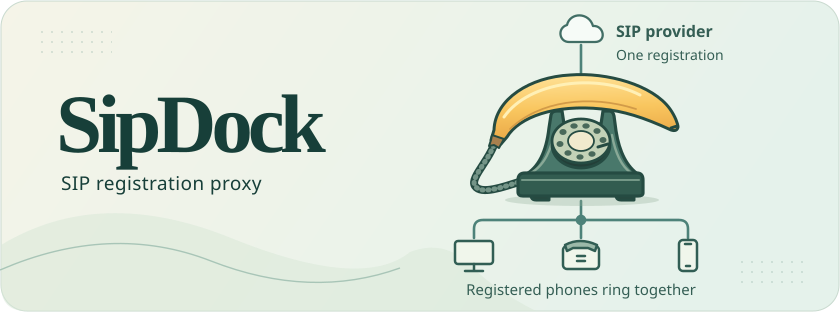
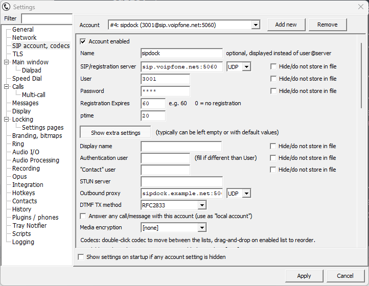
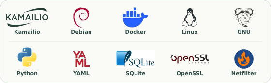

<h1 align="center">🍌 SipDock</h1>



<p align="center">
  <a href="docs/debian-docker.svg"></a>
</p>

<p align="center">
  <a href=".github/workflows/checks.yml"></a>&emsp;
  <a href="#-tests-and-coverage"></a>&emsp;
  <a href="LICENSE.md"></a>
</p>

SipDock lets several SIP phones share a line when its provider accepts only one registration. The provider sees one registered contact, SipDock. Each phone registers locally, and every active contact receives an incoming INVITE in parallel. When one answers, SipDock cancels the other ringing branches. Each phone can place outbound calls through the same line. The provider’s simultaneous-call allowance still applies.

## 🚀 TL;DR - Getting started quick like

Clone this repository using its clone URL:

```sh
git clone https://github.com/bytebraid/sipdock.git
cd sipdock
```
### 🔥 FIREWALL ALERT

Docker proxy can skip over host security BUT -

⛔ **iptables is on by default in this container - you must specify CIDRs to allow**

Read [INSTALL.md](INSTALL.md) and edit `config.yaml` (copy [config.example.yaml](config.example.yaml) on first install). You must add the IPs of all connecting phones and your VoIP provider. 

✅ Then Start SipDock

```sh
docker compose up -d
```

## 🚀 Docker Compose Guidelines 

Check the [installation requirements](INSTALL.md#-requirements), then follow the [install guide](INSTALL.md) for firewall CIDRs, UK provider signalling ranges and first-call checks. Start with the [example YAML](config.example.yaml). Compose reads `config.yaml` by default; set `SIPDOCK_CONFIG=./config.yml` in `.env` to use that filename instead. Keep your existing configuration when upgrading.

```sh
cp config.example.yaml config.yaml    # First installation only
```

### 📃 config.yaml at a glance

1. Set `advertised_host` to a hostname reachable by both the provider and your phones. Set `upstream.domain` to the SIP account domain and `upstream.host` to the provider’s registrar or outbound proxy.
2. Enter the line’s username and password. Set `upstream.auth_username` if the provider uses a different authentication ID. Add the provider’s **inbound signalling** IPv4 CIDRs to `upstream.trusted_sources`; the registrar and calling servers can have different addresses.
3. Add the phones’ observed source networks to `firewall.client_ipv4` or `firewall.client_ipv6`. Empty lists allow local phone traffic only. Choose `max_clients`, and configure TLS or SMTP if needed.
4. Protect `config.yaml` as a credential file. The unprivileged `kamailio` user in the monitor container needs read access. Build from source and start both services.

```sh
docker compose up -d --build
docker compose ps
docker compose logs -f proxy monitor
```

### 👿 Devils and details

Both services log to stdout. Docker rotates four 10 MiB files per container: **80 MiB combined** for the proxy and monitor. Recreate existing containers to apply the limit. The runtime is assembled from Debian packages into a `scratch` image with the required SIP modules, Python runtime, certificate roots, firewall helpers and license notices. Administrative commands below run on the Docker host. After editing the YAML, run `docker compose up -d --force-recreate`.

### 🪶 Featherweight 

On with the gutted debian-slim the runtime files occupy **33.8 MiB**. Future package updates can change the result. 

If you have the prebuilt release archive (**15.7 MiB**), load it on the Docker host and use the matching Compose file:

```sh
docker load -i dist/sipdock-linux-amd64.tar.gz
docker compose up -d --no-build --force-recreate
```

## 📞 Register phones and set capacity

```yaml
max_clients: 16
```

Choose **1–30 registered contacts per line**. The max of 30 is an arbitrary limit, but this tool is a vibe and not tested at scale. 

Omit the setting for the default of 16. One value sets the registrar limit and the parallel call-branch limit. At capacity, an extra contact receives SIP **503**. Existing phones can refresh, and a slot becomes available when a contact expires or unregisters. The upper bound comes from the transaction engine. [Kamailio branch limit](https://www.kamailio.org/wikidocs/cookbooks/6.0.x/core/#max_branches)

| Phone setting | Value |
| --- | --- |
| SIP user or line address | `upstream.username` |
| Authentication ID and password | `upstream.auth_username` (defaults to the line username) and `upstream.password` |
| SIP account domain | `upstream.domain` |
| Registrar and outbound proxy | Reachable SipDock hostname. Use it for registrations **and** calls. |
| Transport | UDP on port 5060, or TLS on TCP 5061 with mutual TLS enabled |

For a client with one combined registration server/domain field, use the provider’s domain and set SipDock as "outbound proxy" for registrations and calls. On a cordless base, assign the SIP line to each handset that should ring. SipDock counts distinct SIP contacts; a base can handle several handsets behind one contact.

### ☎️☎ tSIP example

<p align="center">
  <a href="https://github.com/tomek-o/tSIP"><br/>Small, portable, highly customizable SIP softphone for Windows.</a>
</p>

### 🛜 Network behaviour

After a restart the upstream and phones must re-register. Local leases are capped at ten minutes. **RTP flows directly between the answering device and the provider.** Check two-way audio behind NAT; a working SIP registration verifies signalling only.

## 🔐 Require client certificates

Set `tls.enable: true` to require mutual TLS from **every** phone. A valid client certificate and the line’s SIP digest credentials are both required. The upstream leg continues to use UDP. Even the upstream’s trusted source addresses cannot register a phone over UDP in this mode.

```yaml
tls:
  enable: true
  certificate: /etc/sipdock/certs/fullchain.pem
  private_key: /etc/sipdock/certs/privkey.pem
  client_ca: /etc/sipdock/certs/client-ca.pem
```

Use the [certificate tool and installation guide](certs/README.md) for a private CA, a server certificate and individual phone keys, or use a Let’s Encrypt server chain with your own client CA. Compose mounts only `certs/server/` read-only. **Upgrading an existing TLS install?** Move the server chain, server key and public client CA from `certs/` into `certs/server/` before recreating the proxy. In-container paths are unchanged.

tSIP supports a client certificate from version 0.2.5. Select TLS, the proxy’s certificate hostname and port 5061. Place the phone’s certificate chain and key in one PEM in its `certificates` directory, select it in the TLS tab and enable server verification. The Gigaset N300 IP documents server/CA certificate management and has no documented client-key support. Use UDP mode if that model must register directly. [tSIP TLS guide](https://tomeko.net/software/SIPclient/howto/tls_srtp.php) · [Gigaset N300 IP manual](https://gse.gigaset.com/fileadmin/legacy-assets/CustomerCare/Manuals/N300-N300A_IP/A31008-M2214-L101-2-7619_13-03-2017_en_IE-UK.pdf)

## 🛡️ Firewall and port map

The proxy installs default-drop INPUT policies with `iptables` and `ip6tables` before starting SIP. It permits loopback, replies to outbound traffic, essential IPv6 neighbor discovery and the following explicit grants. Startup fails if either policy cannot be installed. Kamailio runs with its privileges dropped.

| Source setting | Published port | Purpose |
| --- | --- | --- |
| `firewall.client_ipv4`, `firewall.client_ipv6` | UDP 5060 **or** TCP 5061 | Phone signalling on the enabled transport |
| `upstream.trusted_sources` | UDP 5060 | Provider signalling |
| `firewall.health_sources` | TCP 5062 → 8080 | Load-balancer and monitor probes |
| `firewall.admin_sources` | 127.0.0.1 TCP 8081 | Registration report via the Docker host |

Use the supplied private Docker bridge. **Host networking would apply the firewall rules to the host.** If the bridge subnets overlap an existing network, change the subnets, static container addresses and corresponding firewall entries together. External IPv6 requires working host IPv6 routing. Preserve the original source address through any load balancer. For TLS, use TCP passthrough. Point signalling at one proxy instance so incoming calls reach the instance holding the registrations.

For an ISP-wide phone allowlist, use the IPv4 and IPv6 prefixes **originated** by the ISP’s ASN. Anyone in those ranges can reach the phone signalling port. Keep ISP prefixes separate from trusted provider signalling ranges. Review route changes before updating the list. [RIPE RIS prefix lookup](https://stat.ripe.net/docs/data-api/api-endpoints/ris-prefixes.html)

## 🩺 Health, alerts and registrations

- **Upstream health** — probe `GET /healthz` on host TCP 5062. The response body is `registered` (HTTP 200) after the provider accepts the binding, `ready` (HTTP 200) on an idle standby, or `upstream unregistered` (HTTP 503) while trying to register. Add the probe source CIDRs to `firewall.health_sources`. The endpoint can be healthy with zero local phones.
- **Email notifications** — enable `alerts.enabled` and supply sender, recipient, SMTP host and TLS mode. The monitor retries failed deliveries and sends one alert per outage after the configured failure threshold. A successful probe rearms it. Test by stopping only the proxy and starting it again once the alert arrives. A host outage requires an external monitor.
- **Phone registrations** — open [the local registrations page](http://127.0.0.1:8081/registrations) on the Docker host. It shows upstream state and each active phone’s user agent, contact address, observed source and time to expiry. For a remote server, run `ssh -L 8081:127.0.0.1:8081 user@docker-host` first. The report refreshes every 15 seconds.

### DNS failover with a preferred master

Set `mutex.enabled: false` on the master. This is the default for existing configs. The master starts registering immediately. After a failed SIP registration transaction it waits 2, 4, 8, 16 and then 30 seconds between attempts. It continues at 30 seconds until successful.

On the standby, point the probe at the preferred master. This example uses the master's existing Compose health port.

```yaml
mutex:
  enabled: true
  healthz: "http://master.example.net:5062/healthz"
```

The default target is `$advertised_host/healthz`. A hostname or HTTPS URI tries verified HTTPS first and falls back to HTTP on transport failure. An explicit HTTP URI uses HTTP directly. Without an explicit port the respective defaults are 443 and 80. A valid HTTPS response, including 503, decides that poll. Allow the standby’s probe source in the master’s `firewall.health_sources`. A reverse proxy should forward the response body and `X-SipDock-Instance` header and disable caching.

Check the proxy startup log for its effective role and the standby’s probe URI. Duplicate YAML settings stop startup and report both line numbers. With `logging.debug: true`, the `mutex-poll` thread logs its start, each GET URI, the HTTP status and response body or transport error, the election decision, and the time until the next poll. A healthy master should produce `status=200`, `body=b'registered\n'` and `role=standby`. In the SIP send log, `expires=0` identifies a release and a positive expiry identifies registration or renewal.

| Standby state | Poll interval | Action |
| --- | --- | --- |
| Starting in `ready` | 20s | Stay unbound while the master returns 200. Attempt registration on an error or after the same peer stays `ready` for six complete intervals (120s at startup). |
| Trying to register or already registered | 10s | Retry failed SIP transactions after 30s. When another instance answers `ready` or `registered`, send a contact-specific SIP unregister immediately and return to `ready`. An instance recognizes its own health response if DNS points back to it. |
| After yielding | 30s | Remain unbound while the master reports `registered`. An error triggers takeover. Six complete intervals of continuous `ready` also trigger takeover. |

The standby uses its own SIP Contact user and the configured line and credentials. This lets it release only its own binding. DNS and health polling provide best-effort failover. A network partition can leave both hosts registered, and when the master returns there can be overlap until the standby’s next poll and the provider processes its unregister. If the provider rejects the preferred master while the standby holds the line, stop the standby to release its Contact and allow the master’s next retry to succeed.

## 🔎 Troubleshoot registrations

For shell access, see [break glass: debug shell](INSTALL.md#-break-glass-debug-shell) or run `bash debug.sh --help`. The production image contains no shell.

Set `logging.debug: true`, recreate the proxy and run `docker compose logs --since=2m --timestamps -f proxy`. Re-enable the line on the phone. Match attempts by source IP, port and user agent. A normal exchange is an initial **401** challenge, a second REGISTER and a **200** acceptance. Upstream REGISTER messages are logged separately. Disable debug after diagnosis.

| Observation | Check |
| --- | --- |
| No REGISTER appears | Check DNS, the actual source CIDR, port, transport and outbound proxy. In mTLS mode, check handshake errors and certificate trust. Firewall drops happen before SIP logging. |
| Repeated `initial-challenge` without a retry | Check the reply path and whether the phone answers digest challenges. |
| `unknown-line` / `auth-user-mismatch` | Match the SIP username / authentication ID respectively. |
| `digest-mismatch` / `wrong-or-missing-realm` | Check the password and use the realm from the latest challenge (`sipdock` for local registration). |
| `contact-limit` | Inspect the registrations page. Unregister a stale device, wait for expiry, or raise `max_clients` and recreate the service. |
| Accepted but the phone still reports failure | Confirm the 200 reaches its observed source port. Check which line the device reports and whether its binding is still active. |

## 🧪 Tests and coverage

On a Linux Docker host with OpenSSL, a POSIX shell and Python 3.11 or newer, run the same checks as CI:

```sh
python3 -m venv .venv
.venv/bin/python -m pip install 'coverage>=7,<8' 'PyYAML>=6,<7'
.venv/bin/python tools/check.py
```

The runner measures Python line and branch coverage for `sipdock.py`, builds the production image, then runs real SIP exchanges with a synthetic provider. Wire tests cover registration capacity, overflow and slot reuse, simultaneous ringing and cancellation, outbound calls, email, mTLS, and IPv4/IPv6 firewall isolation. Test credentials and ephemeral certificates stay in the test environment.

The badges show the **last recorded full run**. The coverage badge measures Python unit-test lines. The pass badge counts the four release checks. The runner writes Cobertura XML, coverage JSON and check results under `reports/` and refreshes the two SVG badges. Commit badge changes with the code. GitHub Actions reruns the checks on pushes and pull requests, verifies the badges and uploads the reports. [Workflow](.github/workflows/checks.yml) · [Test hook](tools/check.py)

## 📜 License

SipDock’s original code, documentation and artwork use the [Blue Oak Model License 1.0.0](LICENSE.md). Bundled third-party components retain their own licenses. Their notices are available in the image under `/usr/share/doc` and `/usr/share/common-licenses`.

## ⚔️ Hero Warriors

*Shouts out and dedications due*

<p align="center">
  
</p>

- [Kamailio](https://github.com/kamailio/kamailio) registers the phones and forks each incoming call to the active contacts. A shout-out, too, to [Sipwise’s Kamailio fork](https://github.com/sipwise/kamailio).
- [Debian](https://www.debian.org/) supplies the packages that make up the slim runtime.
- [Docker Engine](https://docs.docker.com/engine/) and [Compose](https://github.com/docker/compose) run the proxy and its health monitor.
- [Linux](https://www.kernel.org/) gives the proxy its own network namespace.
- [GNU](https://www.gnu.org/) provides the [C library](https://www.gnu.org/software/libc/) used by the runtime and [Bash](https://www.gnu.org/software/bash/) for the optional debug shell.
- [Python](https://www.python.org/) starts the service, checks its health and sends outage emails.
- [PyYAML](https://github.com/yaml/pyyaml) reads the [YAML](https://yaml.org/) configuration shared by the proxy and monitor.
- [SQLite](https://www.sqlite.org/) stores the upstream registration settings for Kamailio.
- [OpenSSL](https://openssl-library.org/) powers mutual TLS and issues certificates through the host-side tool.
- [Netfilter](https://www.netfilter.org/projects/iptables/) supplies iptables and ip6tables, which restrict inbound traffic to the configured CIDRs.
